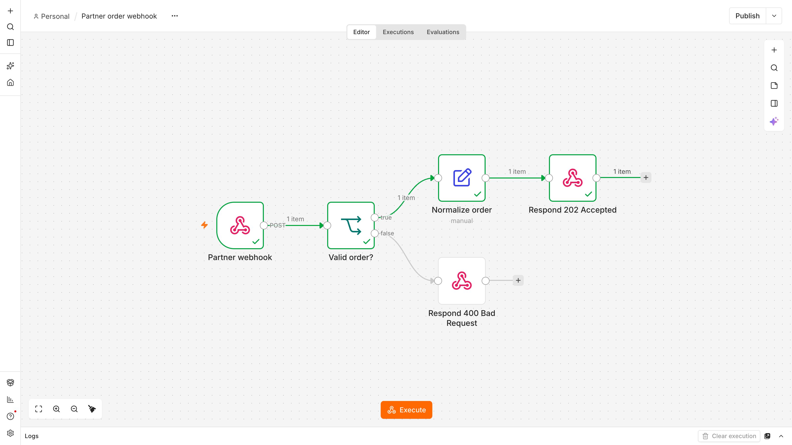
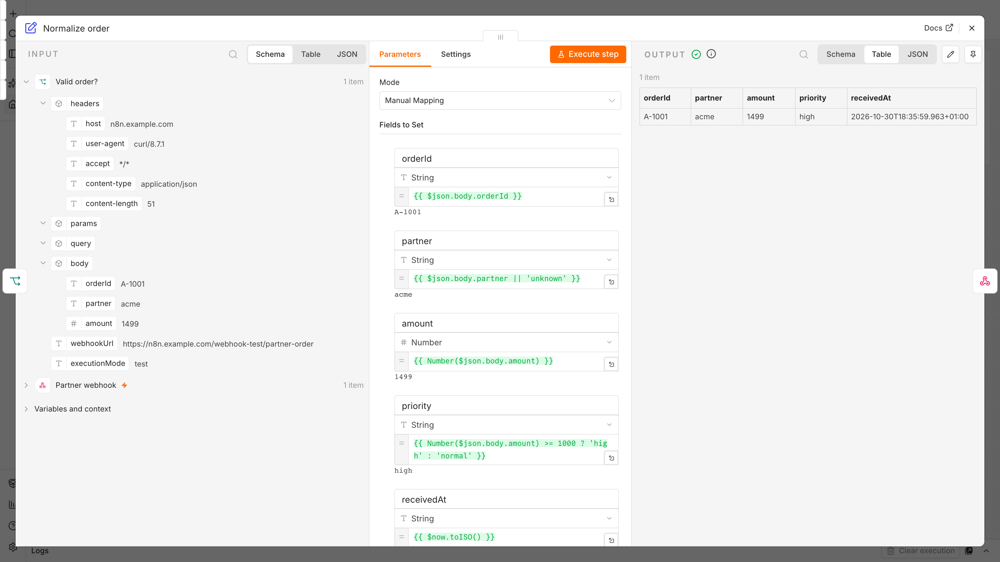

# n8n Community Edition on AWS (Terraform)

n8n runs on ECS Fargate in **queue mode** (main + webhook processors + autoscaled workers), with RDS PostgreSQL,
ElastiCache Redis and a public ALB. Only `/webhook/*` and `/webhook-test/*` are public; everything else
(UI, REST, public API) requires a Cognito login at the ALB first. All infrastructure is in this repo
(default region `eu-central-1`). Hostnames below use the placeholder `n8n.example.com`.

## Why

Most self-hosted n8n setups start as a single VM with n8n, its database and a `.env` file on one box. That's
fine until webhooks and scheduled syncs become business-critical. This repo is a reference for running n8n on
AWS in a secure, observable and scalable way, fully in Terraform, including cost, migration and operations notes.

## Architecture

```
                         Internet (partners, users)
                                   │ 443  (80 → 301 to 443)
           Route53 alias ┌─────────▼─────────────────────────────────┐
        n8n.example.com ─►  ALB  (TLS 1.3/1.2, drop invalid headers, │  access logs → S3 (90 d)
                         │        access logs)                       │
                         │  /webhook/*       → webhook TG   (public) │
                         │  /webhook-test/*  → main TG      (public) │
                         │  everything else  → Cognito login → main  │
                         └─────────┬─────────────────────────────────┘
  private subnets (2 AZ)           │ :5678 (SG: only from ALB)
  ┌────────────────────────────────┼───────────────────────────────────────┐
  │ ECS Fargate, ARM64, n8n 2.43.8 (pinned)                                │
  │   main     x1      UI, API, schedules/pollers (CE: no multi-main)      │
  │   webhook  x2..4   receives production webhooks, enqueues jobs         │
  │   worker   x1..6   executes jobs; scheduled pre-scale for the peaks,   │
  │                    extra capacity on Fargate Spot                      │
  └──────┬───────────────────────┬────────────────────────┬────────────────┘
         │ :5432 TLS             │ :6379 TLS + AUTH       │ egress via NAT → SaaS/CRM APIs
  ┌──────▼───────────┐    ┌──────▼──────────────┐
  │ RDS PostgreSQL 17│    │ ElastiCache Redis 7 │   Secrets Manager (KMS) → injected at task start
  │ KMS, force_ssl,  │    │ KMS, noeviction     │   CloudWatch logs (KMS) / alarms → SNS (KMS) → email
  │ PITR 7 d,        │    │ (Bull job queue)    │   AWS Backup: daily 35 d, monthly 1 y
  │ AWS Backup       │    └─────────────────────┘   ECS Exec (IAM + audit) replaces SSH
  └──────────────────┘
```

Design decisions:

| Concern | Approach |
|---|---|
| Load peaks | UI (main) is separated from execution (workers). Workers scale on CPU plus a configurable **scheduled pre-scale** for known peak windows (`worker_peak_windows`) |
| Webhook reliability | Dedicated webhook processors (min 2, one per AZ) only enqueue; zero-downtime rolling deploys |
| Memory | 2 GB per process, `--max-old-space-size` at 75 %, binary data in DB instead of RAM, one job can't starve the UI |
| Database growth | Execution pruning: 7 days / max 50k executions. RDS storage autoscaling 20 → 100 GB, alarm on free space |
| Observability | Container Insights, 7 CloudWatch alarms (5xx, no healthy host, latency, CPU, memory, DB CPU, DB storage) + backup-failure events → SNS email |
| Backup / restore | RDS PITR (7 d) + AWS Backup plan in a separate KMS-encrypted vault + failure notification |
| Shell access | No SSH, no public IPs on compute. Shell access only via **ECS Exec** (IAM-authenticated, logged in CloudTrail) |
| Secrets | Encryption key, DB password and Redis token are in **Secrets Manager (KMS)**. Encryption key and DB password are `ephemeral` + write-only, **never in Terraform state** |
| Access control / audit | Cognito login in front of everything except webhooks, ALB access logs (who/what/when), CloudTrail |

## Repository layout

One root module, **one file per concern**: easy to read top to bottom and to demo, no premature module
abstraction. Community modules only where they remove boilerplate (`terraform-aws-modules/vpc`).

| File | Content |
|---|---|
| `versions.tf` | Terraform/provider pins, S3 backend (native S3 locking, encrypted), default tags |
| `variables.tf`, `terraform.tfvars.example` | All knobs (sizes, toggles, scaling bounds). Copy the example to `terraform.tfvars` per environment |
| `main.tf` | Naming, account/AZ lookups |
| `network.tf` | VPC, 2 AZ × public / private / database subnets, NAT |
| `security.tf` | Security groups: ALB → tasks → DB/Redis, each tier only from the one in front of it |
| `kms.tf` | One customer-managed key (rotation on) for RDS, Redis, secrets, logs, SNS, backups |
| `secrets.tf` | n8n encryption key + DB password (ephemeral, write-only → not in state) |
| `database.tf` | RDS PostgreSQL 17, TLS enforced, encrypted, PITR |
| `redis.tf` | ElastiCache Redis for queue mode (TLS, AUTH, `noeviction`). Only if `enable_queue_mode` |
| `ecs.tf` | Cluster, task definitions and services: main, worker, webhook. n8n configuration as env vars |
| `iam.tf` | Execution role (pull image, read only these 3 secrets) and task role (ECS Exec only) |
| `alb.tf` | ALB, HTTPS listener, public webhook routes, access-log bucket |
| `auth.tf` | Cognito user pool / client / domain / users for the ALB login. Only if `enable_alb_auth` |
| `dns_tls.tf` | ACM certificate (DNS-validated), temporary self-signed fallback, Route53 record |
| `autoscaling.tf` | CPU target tracking for workers and webhook processors, scheduled peak pre-scaling for workers |
| `monitoring.tf` | Log group, SNS topic + policy, CloudWatch alarms |
| `backup.tf` | AWS Backup vault, plan, selection, failure notification |
| `outputs.tf` | URL, name servers, ECS Exec command, Cognito pool id |
| `workflows/` | Demo workflow (importable JSON) + screenshots of a test run |

Feature toggles: `enable_queue_mode`, `enable_alb_auth`, `certificate_mode`, `db_multi_az`, `redis_ha`,
`single_nat_gateway`, `deletion_protection`. The same code serves dev (cheap) and production (HA).

## How to deploy

Prerequisites: Terraform >= 1.11, AWS CLI v2, an SSO profile for the target account
(e.g. `aws configure sso --profile dev`), and a public Route53 hosted zone for `domain_zone`.

```bash
export AWS_PROFILE=dev

# 1. One-time: state bucket (chicken-and-egg, so created via CLI)
B=n8n-tfstate-$(aws sts get-caller-identity --query Account --output text)-euc1
aws s3api create-bucket --bucket $B --region eu-central-1 \
  --create-bucket-configuration LocationConstraint=eu-central-1
aws s3api put-bucket-versioning --bucket $B --versioning-configuration Status=Enabled
aws s3api put-bucket-encryption --bucket $B --server-side-encryption-configuration \
  '{"Rules":[{"ApplyServerSideEncryptionByDefault":{"SSEAlgorithm":"aws:kms"},"BucketKeyEnabled":true}]}'
aws s3api put-public-access-block --bucket $B --public-access-block-configuration \
  BlockPublicAcls=true,IgnorePublicAcls=true,BlockPublicPolicy=true,RestrictPublicBuckets=true

# 2. Configure (hostname, zone, alarm email, users), then init with the state bucket
cp terraform.tfvars.example terraform.tfvars && $EDITOR terraform.tfvars
terraform init -backend-config="bucket=$B"
terraform apply
```

After the first apply:

1. **DNS:** the parent zone must delegate `domain_zone` to the Route53 name servers
   (`terraform output route53_name_servers`). Then set `certificate_mode = "acm"` and apply again. The
   ALB swaps to the public certificate without downtime.
2. **Alarm email:** confirm the SNS subscription email.
3. **Login:** Cognito emails each user in `auth_users` a temporary password. Further users:
   `aws cognito-idp admin-create-user --user-pool-id $(terraform output -raw cognito_user_pool_id) --username <email>`.
4. **n8n:** open the URL, log in to Cognito, create the n8n owner account, then **Import from file**
   `workflows/partner-order-webhook.json` and publish (activate) the workflow.

Until the DNS delegation exists, point the hostname at the ALB locally:

```bash
dig +short $(terraform output -raw alb_dns_name)          # pick one IP
echo "<ALB-IP> n8n.example.com" | sudo tee -a /etc/hosts   # browser shows a cert warning (self-signed)
```

## Demo

The demo workflow (`workflows/partner-order-webhook.json`) validates a partner order, normalizes it and
answers `202 Accepted` (or `400` if `orderId`/`amount` are missing). A test run with
`{"orderId":"A-1001","partner":"acme","amount":1499}`:



<details>
<summary>"Normalize order" node: input, mapping, output</summary>



</details>

`./demo.sh` wraps all demo calls. It talks to the ALB directly, so it works without DNS or a hosts entry:

```bash
./demo.sh preflight   # AWS login, ALB IPs vs /etc/hosts, ECS services, webhook → 202
./demo.sh valid       # valid partner event → 202 Accepted (webhook processor → Redis → worker)
./demo.sh invalid     # invalid event → 400
./demo.sh protected   # UI/REST/API → 302 to Cognito, /webhook/* public
./demo.sh burst 100   # 100 events, 10 in parallel → all 202
./demo.sh failover    # stops one webhook task under traffic → still only 202s
```

Plain curl equivalent:

```bash
H=n8n.example.com
# while self-signed: add  -k --resolve $H:443:<ALB-IP>

# valid partner event → 202 Accepted, processed by webhook processor → Redis → worker
curl -s https://$H/webhook/partner-order -H 'content-type: application/json' \
  -d '{"orderId":"A-1001","partner":"acme","amount":1499}'

# invalid event → 400
curl -s https://$H/webhook/partner-order -H 'content-type: application/json' -d '{"partner":"acme"}'

# everything else needs the upstream login → 302 to Cognito
curl -s -o /dev/null -w '%{http_code} %{redirect_url}\n' https://$H/
```

Operations:

```bash
terraform output -raw shell_into_main                 # ECS Exec instead of SSH (needs session-manager-plugin)
aws logs tail /ecs/n8n-dev --follow               # logs (JSON) of all n8n processes
# n8n upgrade: bump var.n8n_image (pinned tag) → plan → apply. ECS rolls webhook/worker with zero
# downtime; main is stop-then-start (no two mains: schedules and DB migrations would race).
```

## Assumptions

- The default (`environment = "dev"`) is one environment. Production would use the same code with its own `tfvars`/state
  (ideally its own account) and `db_multi_az`, `redis_ha`, `single_nat_gateway = false`, `deletion_protection`.
- Workflows call arbitrary third-party APIs, so task egress is open (via NAT). Ingress is strictly ALB → tasks.
- No lost webhooks means: as long as one webhook processor and Redis are up, an accepted event is
  persisted in the queue before it is answered. Webhook senders are expected to retry on 5xx (common practice).
  A single-node Redis is a dev simplification (`redis_ha = true` in production).
- Community Edition has no SSO and no audit log. The Cognito login and ALB access logs compensate at the
  edge, so users still log in to n8n itself afterwards.
- The parent DNS zone is managed outside this account, so `domain_zone` must be delegated to Route53.
- When migrating from another instance, its `N8N_ENCRYPTION_KEY` is reused (see below).

## Known gaps / what is missing

- **DNS delegation** of `domain_zone` (NS records at the parent → 4 Route53 name servers). Until
  then: `certificate_mode = "self_signed"` plus a hosts entry. Afterwards it's a one-line switch to `acm`.
- **DB TLS verification:** traffic is encrypted (`rds.force_ssl`), but the RDS CA isn't verified
  (`DB_POSTGRESDB_SSL_REJECT_UNAUTHORIZED=false`). Next: ship the RDS CA bundle in a thin custom image.
- **State contains two secrets:** the Redis AUTH token and the Cognito client secret (no write-only
  arguments in the provider). Mitigation: state bucket is private, versioned and KMS-encrypted.
- **No WAF** yet (rate limiting / managed rules on `/webhook/*`). No per-webhook authentication in the
  demo workflow (use Header Auth or HMAC credentials per partner).
- **Worker scaling** is on CPU + schedule, not on queue depth (n8n queue metrics → CloudWatch would be better).
- **No CI/CD:** applies are run locally. Next: GitHub Actions with OIDC role, plan on PR, apply on merge.
- **Image** pulled from `docker.n8n.io` via NAT. Next: ECR pull-through cache + image scanning, Renovate for version bumps.
- **Restore test** not automated yet (AWS Backup restore testing), DR copy to a second EU region missing.
- Dev sizing: single NAT, single-AZ RDS/Redis, webhook processors oversized (1 vCPU / 2 GB → 0.5 / 1 GB is enough).
- Main is a singleton (CE has no multi-main): an upgrade pauses UI/schedules for ~1–2 min, production webhooks are not affected.

## Features

- n8n reachable via HTTPS on its own hostname (TLS 1.3, HTTP → HTTPS)
- Everything in Terraform: network, compute, database, queue, ingress, DNS, TLS, IAM, secrets, monitoring, backup, login
- Hardening: no SSH / no public compute, KMS everywhere, secrets in Secrets Manager (not in state), least-privilege SGs and IAM, TLS to DB and Redis
- Queue mode with autoscaled workers (Spot for peaks), scheduled peak scaling, 2 webhook processors
- Monitoring + alerting (CloudWatch → SNS email), AWS Backup with failure notification
- Cognito login at the ALB, only `/webhook/*` and `/webhook-test/*` public
- Demo workflow (`workflows/partner-order-webhook.json`)

## Cost estimate

Rough on-demand list prices for eu-central-1 per month (USD ≈ EUR, without n8n license, without data transfer):

| Item | Single VM (baseline) | Dev (as configured) | Production target |
|---|---|---|---|
| Compute | one small general-purpose VM ~€35 | Fargate ARM: main + worker + 2 webhook (1 vCPU / 2 GB) ~€135, peak Spot ~€5 | main 1 vCPU / 2 GB, workers 2 baseline + Spot peaks, webhook 2 × 0.5 vCPU / 1 GB ~€120 |
| Database | on the same VM | RDS t4g.micro single-AZ ~€17 | RDS t4g.small/medium Multi-AZ ~€60–110 |
| Queue | – | Redis t4g.micro ~€13 | Redis 2 nodes Multi-AZ ~€26 |
| Network/ingress | public IP ~€4 | ALB ~€25, NAT ~€40 | ALB ~€25, NAT ×2 ~€80 (or VPC endpoints + 1 NAT) |
| Storage/backup | EBS volume + snapshots ~€10 | included / ~€5 | ~€10 |
| Observability, KMS, secrets, Cognito (<10k MAU free) | – | ~€15 | ~€25 |
| **Total** | **~€50** | **~€250** | **~€350–400**, with Savings Plan / RI ~€300 |

The target costs ~€3.5–4k more per year in infrastructure. In return: no peak outages, no lost webhooks,
tested backups, no SSH exposure, and almost no manual operations. That is cheaper than a few incident days or
engineer days per year. Levers: right-size tasks after a week of metrics, Compute Savings Plan (~20 % on
Fargate), RDS reserved instance (~30 %), webhook processors at 0.5 vCPU. A lean variant (one EC2 in a private
subnet behind the ALB + RDS, no queue mode) would cost ~€120, but doesn't solve the peaks.

## Migration from an existing instance (incl. rollback)

1. **Prepare:** run the old and new instances on the **same n8n version**. Inventory workflows (owner, trigger
   type: webhook / schedule / polling, criticality). Prune old executions. Lower the DNS TTL to 60 s. Put the
   existing `N8N_ENCRYPTION_KEY` into Secrets Manager (`aws secretsmanager put-secret-value`) so existing
   credentials stay decryptable.
2. **Rehearse** in a dev environment with a copy of production: `pg_dump` of the old DB → restore into RDS → start →
   compare counts, run the critical workflows manually, call the webhook URLs.
3. **Cutover** in a quiet window (outside the peak windows): freeze workflow edits → final `pg_dump`
   (workflows, credentials, users; executions optional) → restore → start the new stack → switch DNS. Webhook
   URLs don't change (same hostname / `WEBHOOK_URL`), so webhook senders don't need to change anything. The old
   instance keeps receiving webhooks until DNS has flipped. Stop it right after the switch so schedules don't
   fire twice.
4. **Verify:** alarms green, error rate and executions per workflow compared with the day before, hypercare 1 week.
5. **Rollback:** the old VM and its disk are stopped, not deleted, for 14 days. Rollback = start the old
   instance, switch DNS back (TTL 60 s). The cost: executions/edits made on the new instance in between
   (keep the edit freeze for the first days or export changed workflows via the n8n CLI).

Waves are possible as well: schedule-only workflows first (low risk), webhook workflows last via DNS.

## Operations and ownership

- **Platform owner:** a small named team (one primary per week) owns the AWS account, this repo,
  upgrades and alarms. Business-hours response, SNS → team channel/email.
  **Workflow owners** (business teams) own their workflows; each has an owner and an error workflow that
  notifies them.
- **Routines (low effort):** monthly n8n upgrade via PR (Renovate bumps the pinned tag, CI plans, merge applies),
  quarterly restore test (automated via AWS Backup restore testing), monthly cost/rightsizing glance.
- **Change process:** all infrastructure changes via PR + `terraform plan` in CI. No console clicks, no SSH.
  Human access via SSO only.

## Next steps (priority order)

1. DNS delegation → `certificate_mode = "acm"`
2. Production settings: `db_multi_az`, `redis_ha`, `deletion_protection`, 2 NAT
3. CI/CD with OIDC, Renovate for the n8n image, ECR pull-through cache
4. WAF on the ALB (rate limit `/webhook/*`, AWS managed rules), webhook auth per sender
5. Queue-depth based worker scaling, dashboard
6. RDS CA verification, automated restore tests, DR copy to a second EU region
7. Evaluate the Business license features (SSO, environments/Git) for production, replacing parts of the edge login
